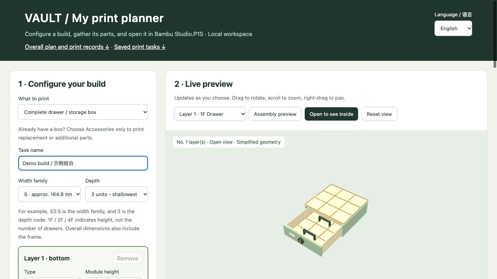
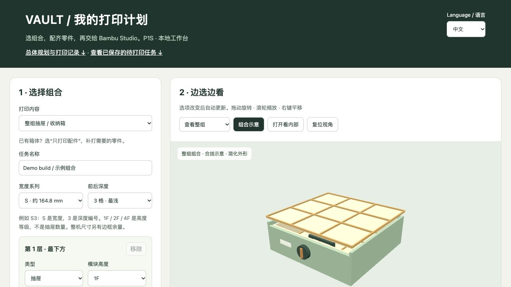
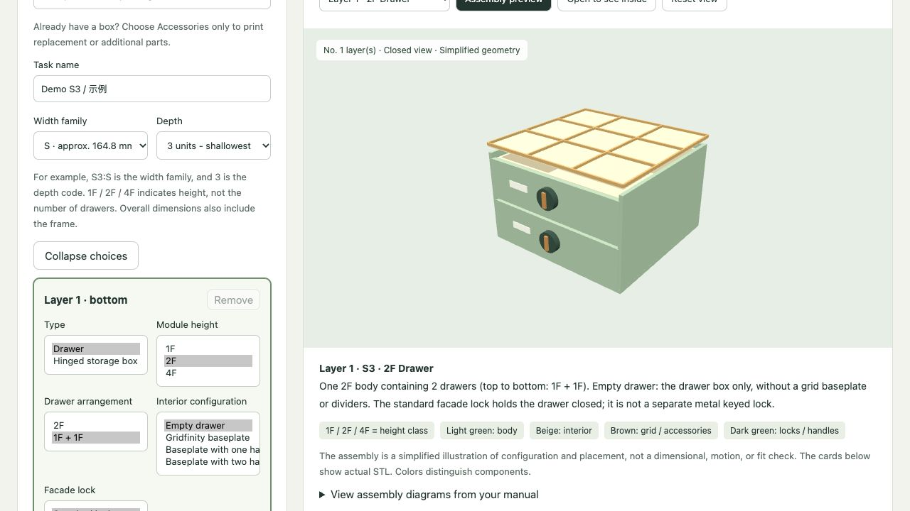
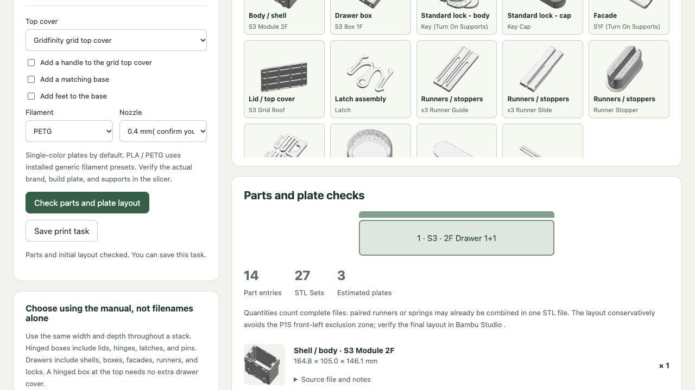
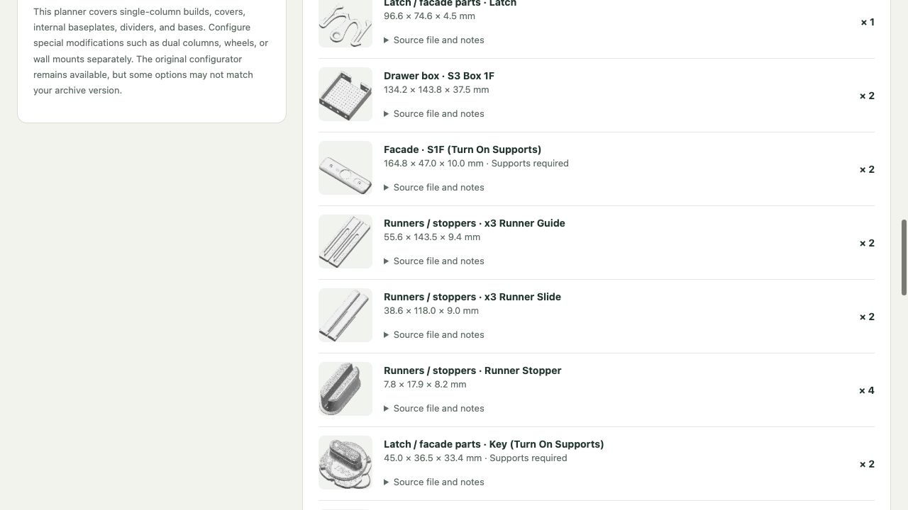
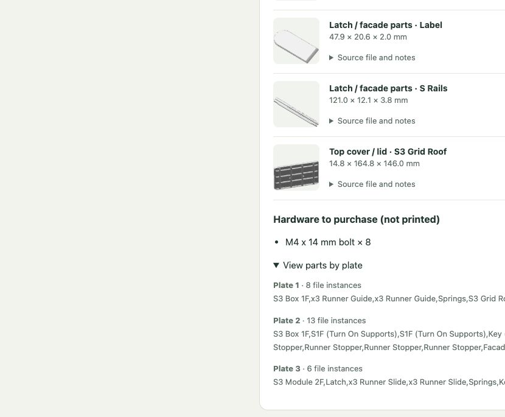

# VAULT Print Planner — Bambu Studio 3D Printing Planner & Codex Skill

English | [简体中文](README.zh-CN.md)

**Plan USSA VAULT modular storage prints for Bambu Lab P1S, from drawer configuration to Bambu Studio 3MF export.** This unofficial, local 3D printing planner also works as a Codex skill. Choose drawers, hinged storage boxes, Gridfinity baseplates, locks, and replacement accessories; preview assemblies, review STL parts lists and hardware, check initial plate fit, and track print progress. Available in English and 简体中文.

**[Download v0.1.0 (pre-release)](https://github.com/hp0411-oss/vault-print-planner-skill/releases/tag/v0.1.0)** · [Installation](#start-here-installation-and-first-use) · [Screenshots](#interface-preview) · [中文说明](README.zh-CN.md)

VAULT models are **not included**: purchase them separately and use your local archive. This is not an official USSA Design or Bambu Lab product.

Download **vault-print-planner-skill.zip** from this repository and extract it first. Paths below refer to the extracted folder.

## Start here: installation and first use

**You can run the website without Codex or a ChatGPT subscription.** The optional skill is for agent-assisted use. This is a local Python application, not a hosted online service or a one-click installer.

### 1. Prepare the software and your purchased models

- Install Python **3.11 or newer**. On Windows, enable the Python installer’s PATH option. Check with `python3 --version` on macOS/Linux or `py --version` on Windows.
- Install Bambu Studio, open it once, finish the setup wizard, and enable **P1S**, your **0.4 or 0.6 mm nozzle**, and PLA/PETG filament profiles. The planner reads profiles from your local Studio configuration; a printer connection is not needed just to plan/export.
- Purchase VAULT models separately and fully extract them. Use the folder directly containing `01. DRAWERS`, `02. SUSTAINERS`, and `03. MODIFICATIONS`, not the ZIP file or the parent Downloads folder. This version was tested with the `261020_VAULT_USSA` archive layout. Keep the matching PDF manuals at the archive root for help images; missing manuals do not prevent the main planner from starting.
- [Download the complete tool package](https://github.com/hp0411-oss/vault-print-planner-skill/raw/refs/heads/main/vault-print-planner-skill.zip) and extract it. Work inside the resulting `vault-print-planner-skill` folder containing `requirements.txt` and `skills/`. If you used GitHub’s **Code → Download ZIP**, extract the inner `vault-print-planner-skill.zip` too.

### 2. Install dependencies and check setup

Replace the example paths below with your actual folders; keep quotes around paths with spaces. `--archive` is the **purchased model folder**, not the tool folder.

macOS / Linux Terminal:

```sh
cd "/absolute/path/to/vault-print-planner-skill"
python3 -m venv .venv
.venv/bin/python -m pip install -r requirements.txt
.venv/bin/python skills/vault-print-planner/scripts/launch.py --archive "/absolute/path/to/261020_VAULT_USSA" --check
```

Windows PowerShell:

```powershell
cd "C:\path\to\vault-print-planner-skill"
py -m venv .venv
.\.venv\Scripts\python.exe -m pip install -r requirements.txt
.\.venv\Scripts\python.exe skills/vault-print-planner/scripts/launch.py --archive "C:\path\to\261020_VAULT_USSA" --check
```

The check must report **OK** for dependencies, local STLs, and P1S PLA/PETG profiles. For a 0.6 mm nozzle, add `--nozzle 0.6` to the check command; also choose 0.6 mm in the webpage. This command checks setup, not every possible model combination or print toolpath.

### 3. Start the website

macOS / Linux:

```sh
.venv/bin/python skills/vault-print-planner/scripts/launch.py --archive "/absolute/path/to/261020_VAULT_USSA" --port 8766
```

Windows PowerShell:

```powershell
.\.venv\Scripts\python.exe skills/vault-print-planner/scripts/launch.py --archive "C:\path\to\261020_VAULT_USSA" --port 8766
```

Keep that terminal running and open **http://127.0.0.1:8766/planner.html** in Chrome or another browser. Do not double-click the HTML file. The address works on the computer running the server; it is not a shareable hosted website. The first load may take a moment to index models and extract local help images. Use the selector at the top right for English / 中文.

### 4. Create the first project

1. Choose a complete build or **Accessories only**, then size, module height, interior, cover, filament, and nozzle.
2. Click **Check parts and plate layout**. Review missing-file/fit warnings, source filenames, whole-file quantities, supports, and hardware. Fix any blockers before export.
3. Click **Save print task**, then **Generate P1S 3MF** in Print tasks. Wait for **Project ready – needs slicing**.
4. On macOS, use **Open in Bambu Studio**. Alternatively, find the generated `.3mf` under `skills/vault-print-planner/assets/app/output/job-<task-id>/` and open it as a **project** in Studio. Windows/Linux users must use this manual route; the automatic-open button is macOS-only.
5. Verify P1S, nozzle, actual filament, build plate, AMS mapping, supports, and first-layer clearance. Slice each plate before sending it yourself. The planner does not automatically start a print.
6. Record completed sets under Overall plan and print progress. For partial completion, use notes; a generated project is not a completed print.

### Restart, update, and troubleshoot

- Stop with **Ctrl+C** in the server terminal. Next time, return to the same tool folder and rerun only the start command; do not recreate the virtual environment each time.
- Tasks live in `skills/vault-print-planner/assets/app/print-jobs/`, progress in `print-progress.json`, and projects in `output/`. Back these up before replacing/upgrading the tool folder. Different extracted copies have separate records.
- **Python not found / too old:** install Python 3.11+ and reopen the terminal. **requirements.txt not found:** change into the extracted tool folder first.
- **Missing Python packages:** rerun pip using the same `.venv` Python used to start the planner. Internet access is needed for dependency installation; normal local planning uses offline mode.
- **Archive must contain 01. DRAWERS / no STL models:** point to the correct fully extracted model root. Cloud-storage placeholders must be downloaded locally.
- **Profile check failed:** complete Studio setup and ensure P1S/nozzle/PLA/PETG profiles exist. The check prints the directory it searches. Portable/Flatpak or unusual Studio installations may use different profile locations and are not verified by this release.
- **Port in use:** use `--port 8767`, then open `http://127.0.0.1:8767/planner.html`. **Connection refused:** keep the terminal running and check the printed address and error messages.
- **Missing help images:** place the original matching PDF manuals at the model archive root and restart. **Parts do not fit / missing files:** review size/version compatibility; do not scale assembly parts to force a fit.
- The server is local and unauthenticated. Do not expose it to the public internet.

**Verification (2026-10-23):** the public ZIP was downloaded and extracted into a clean directory, installed into a new macOS Python 3.13 environment, and tested against a locally purchased archive and existing Studio profiles. Preview, accessories, saving, 3MF export (archive structure), progress records, deletion/recovery, and the English UI passed. The improved preflight passed with profiles and failed clearly when profiles were absent. Windows/Linux commands are provided but have **not** been tested on those operating systems. No physical print or final slicer toolpath validation was performed during this installation test.

## Interface preview

Actual interface screenshots using an example configuration, with no personal print records. The 3D assembly is a simplified illustration for feature reference, not a printable model or a validated assembly simulation. Model files must be purchased separately and used locally.

**English — configuration and open assembly preview**



**简体中文 — 中文选型与组合预览**



## Explore options and review the print checklist

Use **Show all choices** above the layer settings to expand module type, height, drawer arrangement, interior, and lock choices together. Use **Collapse choices** to return to compact dropdowns. Available options depend on the chosen size; 1F / 2F / 4F are height classes, not drawer counts. The example uses a 2F shell containing two 1F drawers.



After choosing a build, filament, and nozzle, select **Check parts and plate layout** and scroll down:

| What you can review | What it means |
| --- | --- |
| Complete parts list | Source STL filenames, quantities, dimensions, thumbnails, support flags, and source notes. Quantities count complete STL files; a file can contain paired parts. |
| Filament and nozzle | PLA or PETG and 0.4 / 0.6 mm are selected for the whole task. The tool does not automatically recommend a different material per part. Verify the actual product profile in Studio. |
| Does it fit your printer? | Initial geometric layout for the supported P1S profile. Missing files or parts that cannot fit are reported. This does not certify fit for other printers or validate the final toolpaths. |
| Plates and hardware | An initial per-plate file list plus separately purchased hardware and quantities. Hardware varies with the selected build. |
| Guidance | Size naming, stacking and assembly references, source notes, support flags, and preflight reminders. Manuals are read from the local archive. |

**Example check:** S3, 2F shell, two 1F drawers, grid cover, PETG, 0.4 mm nozzle: 14 part entries, 27 whole-file instances, and 3 initial plates. This example is illustrative, not a universal bill of materials or a validated ready-to-print project.





The example hardware list contains **8 × M4 × 14 mm bolts**. Verify head shape, length, and assembly requirements against the matching manual before buying; the abbreviated list is not a product recommendation. Inspect actual start-line, brim, supports, first layer, and warnings after slicing every plate in Bambu Studio.



## Chinese / English switch

Use the language selector at the top right of the planner. Your current configuration and accessory quantities carry over, and the browser remembers your language. Both versions share the same saved tasks and print records. User-entered names, notes, original filenames, and images from the original manuals retain their original language. Save progress-record edits before switching languages.

## Model purchase, local deployment, and manuals

**This tool does not include or distribute VAULT model files. Each user must purchase the models from the designer or an authorized seller and comply with the model license.** Download and extract your purchased archive on your own computer, then pass that local folder to `--archive`. This tool and its AGPL license do not grant rights to the VAULT models.

Keep model files and anything containing their geometry local: STL/STEP/3MF files, converted meshes, print projects, and model archives must not be uploaded to this repository or included in release packages. The local planner reads your archive to preview parts and prepare print projects; it does not require uploading the models to GitHub.

Manuals may be used as reference material for selection, printing, and assembly. Read the user’s local manuals when needed. A manual may also be included as a reference resource when its redistribution is permitted by the rights holder; permission to use a local manual is not automatically permission to republish it. No third-party manuals are bundled in the current package.

## Install the skill

First complete the standalone setup above. The skill folder includes its own `requirements.txt`; if installing only that folder, create a virtual environment there and install those dependencies before running `scripts/launch.py`.

Copy `skills/vault-print-planner` into `~/.codex/skills/` (or your `$CODEX_HOME/skills/` folder). Start a new session and invoke `$vault-print-planner`.

Example: “Use $vault-print-planner to configure an M5 drawer build, add two replacement baseplates, and check clearance from the front purge line.”

## Printing scope

The planner targets the P1S, 0.4 / 0.6 mm nozzles, and PLA / PETG. Exporting or opening a project does not start printing. A 3MF export still needs slicer inspection: verify the actual printer, nozzle, filament, plate, AMS mapping, start G-code, brim, and supports.

The packaged planner includes conservative front and edge clearances. Larger parts may require manual layout or separate plates; never scale assembly parts to fit. Old exported projects do not automatically receive updated clearances. Simplified previews do not validate dimensions, assembly tolerances, motion, load capacity, or stability.

## Frequently asked questions

### Is this a VAULT model download or a 3D printing planner?

It is a planner for your purchased USSA VAULT models. No STL model library is distributed. The tool maps configurations to your local files and prepares editable print projects.

### Can I use it with Bambu Studio and a P1S?

Yes. Initial planning supports Bambu Lab P1S, 0.4 / 0.6 mm nozzles, and PLA / PETG. Export a 3MF, then inspect and slice it in Bambu Studio. It is not a slicer or an automatic printer queue.

### Does the Codex skill require Codex to run the website?

No. The standalone Python web application works in a local browser. Install the optional skill for agent-assisted planning; see the setup instructions above.

### Can I print just a Gridfinity baseplate or replacement lock?

Use Accessories only to select compatible parts without adding a complete drawer body. Options depend on your model archive and selected size; this is not a general-purpose Gridfinity model generator.

### Does it support Windows and Linux?

Instructions are included, but the clean-install workflow has only been tested on macOS. See the verification notes and known limitations before installing.

## Development

Chinese frontend sources are `planner.html`, `planner-preview.js`, and `planner-overview.js` under `skills/vault-print-planner/assets/app/`. Edit `tools/translations.tsv` and run `python3 tools/build_languages.py` to regenerate English assets and the response translation dictionary. System messages are translated; user-authored text and model paths are preserved. The original upstream configurator is separate from the bilingual planner.

## Credits and license

Based on a downloaded version of [marcelfarres/vault-configurator](https://github.com/marcelfarres/vault-configurator), under [GNU AGPL v3](LICENSE). Additions include the bilingual planner, accessory-only mode, task deletion and recovery, completion records, assembly previews, skill instructions, and conservative P1S clearances. This package does not retain upstream Git history or claim a verified upstream commit.

Three.js retains its bundled license. VAULT models, manuals, and brands belong to USSA Design and are not licensed by this repository. This is not an official USSA Design or Bambu Lab product. Designer print statistics are excluded; the slicer is authoritative for weight and time.

Models, generated files, caches, personal paths, and print records remain local and are excluded by `.gitignore`.
